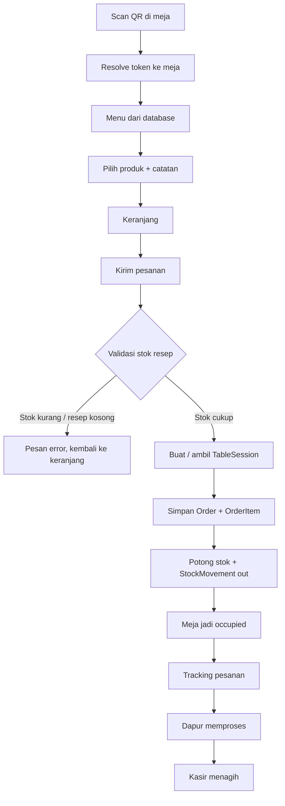
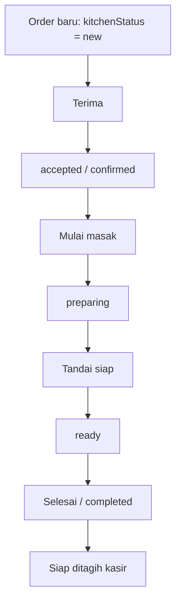
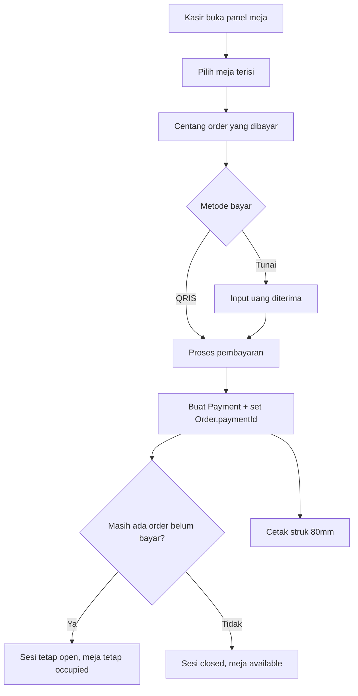
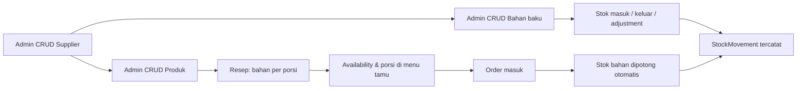

# RestoFlow — Sistem QR Ordering & POS Restoran

Aplikasi **full-stack** untuk operasional restoran: tamu memindai QR di meja untuk
melihat menu dan memesan, dapur memproses pesanan lewat **Kitchen Display System (KDS)**,
kasir menagih dan menerima pembayaran di **POS**, dan admin mengelola menu, meja, kode QR,
inventori, supplier, serta laporan penjualan.

Dibangun sebagai satu aplikasi Next.js dengan empat permukaan peran (`/order`, `/staff`,
`/admin`, plus pemilih peran di `/`), sehingga satu pesanan mengalir utuh dari QR meja →
keranjang → docket dapur → tagihan kasir → laporan admin.

> **Status pengembangan:** sebagian besar modul sudah tersambung ke database PostgreSQL
> (Supabase) melalui Prisma 7 dan NextAuth v5. Modul yang masih berupa UI/mock: state
> keranjang & toast di sisi klien, metadata restoran, serta halaman admin staff, shifts,
> dan settings.

---

## Tech Stack

| Layer               | Teknologi                                                              |
| ------------------- | ---------------------------------------------------------------------- |
| Framework           | Next.js 16 (App Router, React Server Components), React 19             |
| Bahasa              | TypeScript (strict)                                                    |
| Database            | PostgreSQL (Supabase) via Prisma 7 + `@prisma/adapter-pg`              |
| Auth                | NextAuth v5 (credentials), hash password `argon2`, role-based guard    |
| Styling             | Tailwind CSS v4 (`@theme` di `app/globals.css`), shadcn/Base UI        |
| Ikon                | lucide-react                                                           |
| Penyimpanan gambar  | Supabase Storage (bucket publik)                                       |
| QR code             | `qrcode` — SVG dibuat di server, payload memakai `sessionToken` meja   |
| Validasi            | Zod                                                                    |
| Font                | Plus Jakarta Sans (heading) / Inter (body)                             |
| Build & tooling     | npm, Turbopack, ESLint (flat config), `tsx` untuk seed                 |

---

## Fitur Utama

### Halaman Publik (Tanpa Login)

| Fitur              | Keterangan                                                                                                         |
| ------------------ | ------------------------------------------------------------------------------------------------------------------ |
| **Landing `/`**    | Pemilih peran: Customer QR Order, Kitchen Display, Kasir & Billing, Admin & Analytics                              |
| **Login `/login`** | Login kredensial untuk admin/kitchen/cashier, lalu diarahkan ke halaman sesuai peran                                |
| **QR Meja**        | Setiap meja punya `sessionToken` unik; QR berisi `${NEXT_PUBLIC_APP_URL}/order/table/{sessionToken}`               |
| **Menu Tamu**      | Kategori + pencarian produk, harga Rupiah, ketersediaan porsi dihitung dari stok resep                             |

### Tamu (Scan QR, Tanpa Akun)

| Fitur                 | Keterangan                                                                                                     |
| --------------------- | -------------------------------------------------------------------------------------------------------------- |
| **Menu per meja**     | Token QR di-resolve ke meja (`resolveTableByToken`), tautan tanpa token jatuh ke meja demo                     |
| **Detail produk**     | Dialog detail dengan deskripsi, harga, dan catatan per item                                                    |
| **Keranjang**         | Tambah/kurang qty, hapus item, total dihitung di klien                                                         |
| **Kirim pesanan**     | `createOrderAction`: validasi stok resep, potong stok, buat/ambil `TableSession`, set meja `occupied`           |
| **Tracking pesanan**  | Halaman `/order/[orderId]` menampilkan timeline status (diterima → dimasak → siap → selesai)                    |
| **Penolakan aman**    | Meja `reserved`/`cleaning`/`waiting_payment` dan stok tidak cukup ditolak dengan pesan jelas                    |

### Dapur (Kitchen Display System)

| Fitur                | Keterangan                                                                                    |
| -------------------- | --------------------------------------------------------------------------------------------- |
| **KDS 4 kolom**      | `Baru` → `Diterima` → `Memasak` → `Siap`, sesuai status teknis `new`/`accepted`/`preparing`/`ready` |
| **Aksi satu klik**   | Tombol `Terima`, `Mulai Masak`, `Tandai Siap`, `Selesai` memanggil `advanceKitchenAction`       |
| **Timer & urgensi**  | Lama pesanan berjalan ditampilkan; pesanan yang terlalu lama ditandai                          |
| **Station**          | Setiap item punya station (`grill` / `wok` / `bar`) yang diturunkan dari kategori produk        |

### Kasir (POS & Billing)

| Fitur                    | Keterangan                                                                                   |
| ------------------------ | -------------------------------------------------------------------------------------------- |
| **Panel meja**           | Status meja: `available`, `occupied`, `waiting_payment`, `reserved`, `cleaning`              |
| **Billing per order**    | Kasir memilih order yang belum dibayar pada sesi meja aktif                                  |
| **Metode pembayaran**    | Hanya **QRIS** dan **Tunai**; tunai menghitung uang diterima dan kembalian                    |
| **Pembayaran per order** | Satu `Payment` bisa menutup beberapa order; `Order.paymentId` menandai order lunas            |
| **Tutup sesi otomatis**  | Sesi & meja ditutup/dikembalikan ke `available` hanya bila tidak ada order belum bayar        |
| **Struk 80mm**           | `/staff/cashier/receipt/[paymentCode]` dicetak lewat browser (CSS print 80mm)                 |
| **Riwayat pembayaran**   | `/staff/cashier/payments` menampilkan daftar pembayaran beserta detailnya                    |

### Admin (Role `admin`)

| Modul             | Keterangan                                                                                 |
| ----------------- | ------------------------------------------------------------------------------------------ |
| **Dashboard**     | KPI penjualan, order aktif, status meja, pendapatan/pembayaran harian, produk terlaris      |
| **Sales**         | Laporan penjualan & pembayaran per periode                                                  |
| **Categories**    | CRUD kategori produk (nama, slug, urutan)                                                   |
| **Menu**          | CRUD produk: nama, slug, deskripsi, harga, kategori, gambar ke Supabase Storage             |
| **Recipe**        | `/admin/menu/[id]/recipe` — komposisi bahan per porsi, dipakai untuk potong stok & availability |
| **Tables**        | CRUD meja (kode, jumlah kursi, area) dengan status reaktif                                  |
| **QR Tables**     | `/admin/qr-tables` — QR scannable asli (SVG dari `qrcode`) per meja                          |
| **Orders**        | Daftar & detail order lintas meja, filter status                                            |
| **Payments**      | Riwayat pembayaran seluruh kasir                                                            |
| **Inventory**     | KPI stok, status `IN_STOCK`/`LOW_STOCK`/`OUT_OF_STOCK`, stok masuk/keluar/adjustment + riwayat |
| **Suppliers**     | CRUD supplier, relasi ke bahan baku                                                          |
| **Staff / Shifts / Settings** | Masih **UI template** (belum tersambung ke database)                             |

---

## Alur Proses Bisnis Sistem

### 1. Alur Tamu (QR Ordering)



### 2. Alur Dapur (KDS)



### 3. Alur Kasir (Billing & Pembayaran)



### 4. Alur Data Inventori, Resep & Ketersediaan Menu



> **Catatan:** `OrderItem` menyimpan **snapshot** `productName` dan `unitPrice` saat
> checkout, sehingga riwayat pesanan tetap akurat meskipun produk diubah atau dihapus.
> `total = subtotal`; service charge dan pajak sengaja tidak dimodelkan.

---

## Kelebihan Project

1. **Alur end-to-end nyata** — satu pesanan benar-benar mengalir dari QR meja, keranjang,
   docket dapur, tagihan kasir, struk, sampai laporan admin di database yang sama.
2. **Status tidak hanya warna** — setiap status memakai triplet ikon + label + warna
   (PRD §26), aman untuk pengguna dengan buta warna.
3. **Stok berbasis mutasi** — stok bahan tidak pernah ditulis langsung; setiap perubahan
   mencatat `StockMovement` (`in`/`out`/`adjustment`) dengan `stockBefore`/`stockAfter`
   dan guard optimistik `updateMany({ where: { stock: before } })`.
4. **Resep menggerakkan menu** — ketersediaan dan jumlah porsi di menu tamu dihitung dari
   stok bahan, dan pesanan ditolak bila stok tidak mencukupi.
5. **QR meja asli** — SVG dibuat server-side dengan `qrcode` dari `sessionToken`, bukan
   pola dekoratif yang hanya mirip QR.
6. **Pembayaran fleksibel** — satu pembayaran dapat menutup beberapa order, dengan
   proteksi agar dua kasir tidak membayar order yang sama.
7. **Role guard terpusat** — `proxy.ts` menjaga `/admin`, `/staff/kitchen`,
   `/staff/cashier`, dan `/staff/orders` sesuai peran.
8. **Desain konsisten** — sistem visual *Warm Ember* (`#EA580C`) dengan Plus Jakarta Sans /
   Inter dan angka tabular untuk tampilan operasional yang mudah dipindai.
9. **Seed idempoten** — `prisma/seed.ts` aman dijalankan berulang: meja yang sudah ada
   tidak diubah (token QR tetap valid), demo order hanya dibuat saat database masih kosong.

---

## Kekurangan & Keterbatasan

1. **Tanpa payment gateway** — QRIS hanya dicatat sebagai metode; tidak ada integrasi
   Midtrans/Xendit atau pemrosesan QRIS nyata.
2. **Tanpa realtime** — belum ada WebSocket/push; layar dapur & kasir memperbarui data
   lewat revalidasi/refresh, bukan siaran langsung.
3. **Belum ada cancel/refund** — pembatalan order dan pengembalian stok (mutasi `in`
   yang merujuk kode order) belum diimplementasi.
4. **Modifiers belum dimodelkan** — level pedas, tambahan topping, dan sejenisnya belum ada
   di skema maupun UI.
5. **Sebagian UI masih mock** — halaman admin **staff**, **shifts**, **settings**, state
   keranjang/toast (`lib/store.tsx`), dan metadata restoran (`lib/mock-data.ts`).
6. **Tanpa service charge & pajak** — kolomnya sengaja dihapus; `Order.total = Order.subtotal`.
7. **Metode pembayaran terbatas** — hanya `QRIS` dan `CASH`; nilai legacy sudah dinormalisasi.
8. **Belum ada test/CI** — verifikasi manual lewat `npm run lint`, `npx tsc --noEmit`,
   dan `npm run build`.
9. **Migrasi butuh TTY** — `prisma migrate dev` interaktif; di shell non-interaktif harus
   membuat SQL migrasi manual lalu `npx prisma migrate deploy`.
10. **Cetak struk lewat browser** — belum ada integrasi printer thermal/POS hardware.

---

## Struktur Folder Penting

```
app/
├── page.tsx                 # Landing pemilih peran
├── login/                   # Login NextAuth
├── order/
│   ├── table/[token]/       # Menu tamu dari QR meja
│   ├── cart/                # Keranjang
│   └── [orderId]/           # Tracking pesanan
├── staff/
│   ├── kitchen/             # Kitchen Display System
│   ├── cashier/             # POS, payments, receipt/[paymentCode]
│   └── orders/              # Daftar order staf
├── admin/                   # Dashboard, sales, menu(+recipe), categories,
│                            # tables, qr-tables, orders, payments,
│                            # inventory, suppliers, staff, shifts, settings
└── api/auth/[...nextauth]/  # Handler NextAuth
components/
├── customer/                # menu, cart, tracking, product card/dialog
├── kitchen/                 # KDS
├── cashier/                 # POS, payments, receipt
├── admin/                   # Layar admin per modul
├── ui/                      # Komponen dasar (button, dialog, table, ...)
└── brand-logo.tsx, status-badge.tsx, time-label.tsx, ...
lib/
├── action.ts                # Server actions (CRUD, order, kitchen, payment, stok)
├── orders.ts                # Query & mapper data order/payment/dashboard
├── inventory.ts             # Helper stok murni (tanpa prisma)
├── inventory-queries.ts     # Query inventori
├── recipe.ts                # Helper resep murni
├── recipe-queries.ts        # Availability & resep dari DB
├── resolve-table.ts         # Token QR → meja
├── qrcode.ts                # URL & SVG QR meja
├── supabase-storage.ts      # Upload gambar produk
├── auth-types.ts            # Daftar role & landing path
├── mock-data.ts, store.tsx  # Sisa data/state mock (transisional)
└── generated/prisma/        # Client Prisma (hasil generate)
prisma/
├── schema.prisma            # Skema database
├── migrations/              # Riwayat migrasi
└── seed.ts                  # Seed user, meja, inventori, resep, demo order
planning/                    # PRD (sumber kebenaran flow & requirement)
templete/                    # Mockup HTML & screenshot referensi visual
auth.ts, proxy.ts            # Konfigurasi NextAuth & guard route
DESIGN.md                    # Sistem visual Warm Ember
```

---

## Instalasi & Menjalankan Project

### Prasyarat

- Node.js 20+ dan npm
- Database PostgreSQL (lokal atau Supabase)
- Bucket Supabase Storage (publik) untuk gambar produk

### Langkah

```bash
# Clone & masuk folder project
cd sistem-restaurant

# Install dependency (postinstall otomatis menjalankan prisma generate)
npm install

# Buat file .env (lihat daftar variabel di bawah)
# lalu isi kredensial database, auth, dan Supabase

# Terapkan migrasi ke database
npx prisma migrate deploy

# (Opsional) regenerasi client Prisma
npx prisma generate

# Seed user, meja, inventori, resep, dan demo order
npx tsx prisma/seed.ts

# Jalankan development server
npm run dev
```

Buka browser: `http://localhost:3000`

### Environment Variables

| Variabel                        | Keterangan                                                        |
| ------------------------------- | ----------------------------------------------------------------- |
| `DATABASE_URL`                  | Connection string PostgreSQL (pooled, dipakai Prisma Client)      |
| `DIRECT_URL`                    | Connection string langsung untuk migrasi                           |
| `NEXT_PUBLIC_APP_URL`           | Base URL aplikasi, dipakai menyusun payload QR meja               |
| `AUTH_SECRET`                   | Secret NextAuth v5                                                 |
| `NEXT_PUBLIC_SUPABASE_URL`      | URL project Supabase                                               |
| `NEXT_PUBLIC_SUPABASE_ANON_KEY` | Anon key Supabase                                                  |
| `NEXT_PUBLIC_SUPABASE_BUCKET`   | Nama bucket publik untuk gambar produk                             |
| `ADMIN_EMAIL` / `ADMIN_PASSWORD`     | Kredensial akun admin (dibaca seed)                          |
| `KITCHEN_EMAIL` / `KITCHEN_PASSWORD` | Kredensial akun kitchen (dibaca seed)                        |
| `CASHIER_EMAIL` / `CASHIER_PASSWORD` | Kredensial akun kasir (dibaca seed)                          |

> Jangan commit file `.env`. Semua nilai sensitif hanya ada di environment lokal.

### Akun Demo

Akun dibuat oleh `prisma/seed.ts` dari variabel `.env` di atas (password minimal 8
karakter, di-hash dengan argon2):

| Role     | Email             | Password              | Landing             |
| -------- | ----------------- | --------------------- | ------------------- |
| Admin    | `ADMIN_EMAIL`     | `ADMIN_PASSWORD`      | `/admin`            |
| Kitchen  | `KITCHEN_EMAIL`   | `KITCHEN_PASSWORD`    | `/staff/kitchen`    |
| Cashier  | `CASHIER_EMAIL`   | `CASHIER_PASSWORD`    | `/staff/cashier`    |

Seed juga membuat 10 meja (A01–A05 Indoor, B01–B03 Teras, C01–C02 VIP), 5 supplier,
30 bahan baku, resep untuk produk yang ada, serta sesi/order/pembayaran demo saat tabel
`TableSession` masih kosong.

### Perintah Lain

```bash
npm run build                    # prisma generate + production build
npm run lint                     # eslint
npx tsc --noEmit                 # typecheck (tidak ada script khusus)
npx prisma studio                # inspeksi database
npx prisma migrate dev --name <slug>   # migrasi baru (butuh TTY interaktif)
npx tsx prisma/seed.ts --recipes-only  # hanya lengkapi bahan + resep
```

---

## Route Penting

| URL                                | Deskripsi                            |
| ---------------------------------- | ------------------------------------ |
| `/`                                | Landing pemilih peran                |
| `/login`                           | Login staf (admin/kitchen/cashier)   |
| `/order/table/[token]`             | Menu tamu dari QR meja               |
| `/order/cart?token=...`            | Keranjang                            |
| `/order/[orderId]`                 | Tracking pesanan                     |
| `/staff/kitchen`                   | Kitchen Display System               |
| `/staff/cashier`                   | POS, billing & pembayaran            |
| `/staff/cashier/payments`          | Riwayat pembayaran                   |
| `/staff/cashier/receipt/[paymentCode]` | Struk 80mm (siap cetak)          |
| `/staff/orders`                    | Daftar order staf                    |
| `/admin`                           | Dashboard admin                      |
| `/admin/sales`                     | Laporan penjualan                    |
| `/admin/menu`, `/admin/menu/[id]/recipe` | Menu & resep                   |
| `/admin/categories`                | Kategori produk                      |
| `/admin/tables`, `/admin/qr-tables`| Meja & QR meja                       |
| `/admin/orders`, `/admin/payments` | Order & pembayaran                   |
| `/admin/inventory`                 | Inventori bahan baku                 |
| `/admin/suppliers`                 | Supplier                             |
| `/admin/staff`, `/admin/shifts`, `/admin/settings` | Masih UI template     |

---

## Model Relasi (Ringkas)

```
DiningTable ──< TableSession ──< Order ──< OrderItem >── Product
                      │             │
                      │             └── paymentId ──> Payment (cash | qris)
                      └──< Payment

Supplier ──< Ingredient ──< StockMovement (in | out | adjustment)
                              ^
Product ──< RecipeItem >──────┘   (bahan per 1 porsi)

User(role: admin | kitchen | cashier) ──< Payment (cashierId)
                                      └──< StockMovement (createdById)
```

Enum status utama:

- `TableStatus`: `available`, `occupied`, `waiting_payment`, `reserved`, `cleaning`
- `TableSession.status`: `open`, `closed`; `billStatus`: `not_requested`, `requested`, `processing`, `paid`
- `OrderStatus`: `pending`, `confirmed`, `preparing`, `ready`, `completed`, `cancelled`
- `KitchenStatus`: `new`, `accepted`, `preparing`, `ready`
- `PaymentMethod`: `cash`, `qris`; `PaymentStatus`: `pending`, `paid`, `failed`, `refunded`

---

## Roadmap / Pengembangan Lanjutan

- Integrasi payment gateway / QRIS nyata dan rekonsiliasi otomatis
- Alur cancel/refund order dengan pengembalian stok (mutasi `in` per kode order)
- Migrasi halaman admin staff, shifts, dan settings ke database
- Modifiers produk (level pedas, extra topping, catatan terstruktur)
- Pembaruan realtime (WebSocket/SSE) untuk KDS dan panel kasir
- Pencarian, filter, dan pagination lanjutan di daftar order/pembayaran
- Test otomatis dan pipeline CI
- Integrasi printer thermal/POS hardware

---

## Referensi

- **PRD & alur produk:** `planning/restaurant-qr-ordering-pos-prd.md`
- **Sistem visual:** `DESIGN.md` (Warm Ember `#EA580C`, Plus Jakarta Sans / Inter)
- **Mockup & screenshot referensi:** `templete/` (customer, kasir, KDS, admin)
- **Panduan kontribusi internal:** `AGENTS.md`
